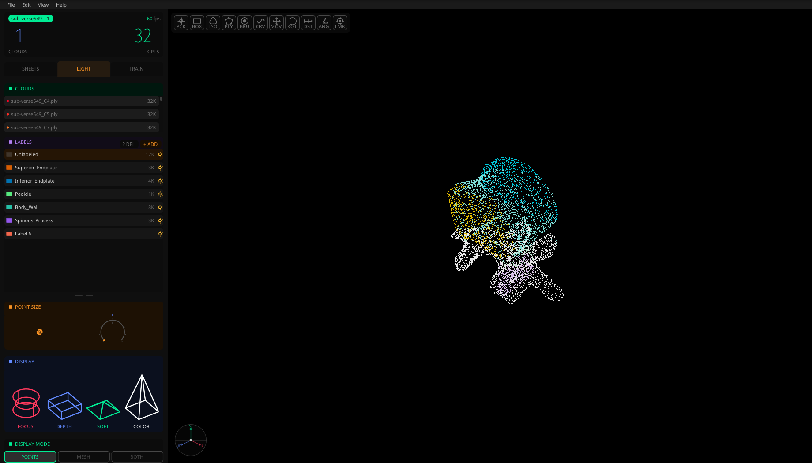

# Lithium

**Label 3D point clouds on your own computer.** Lithium is a desktop app for
browsing large collections of point clouds, painting per-point labels, and
training segmentation models on the result. It runs offline: no account, no
upload.



## What it does

- **Browse** hundreds of clouds as a gallery and organise them into projects.
- **Label** individual points with pick, box, lasso, polygon, brush and curve
  tools. Every stroke saves itself and can be undone.
- **Share** a project as a single `.li` file: clouds, labels, or both.
- **Train** Point Transformer V3 models on your labels and run them on new
  clouds (optional; needs a CUDA machine).

Reads PLY, LAS/LAZ and NPZ. Runs on Windows and Linux, and from source on
macOS.

## Install

You need Git and a GPU with OpenGL 4.1 or newer, which most computers from the
last decade have with current drivers.

```bash
git clone https://github.com/saffffari/Lithium.git
cd Lithium
```

Then run the setup script. It installs a private Python 3.12 environment with
[uv](https://docs.astral.sh/uv/) and launches Lithium:

- **Windows (PowerShell):** `.\setup.ps1`
  If scripts are blocked: `powershell -ExecutionPolicy Bypass -File .\setup.ps1`
- **macOS / Linux:** `./setup.sh`

After that, start Lithium with `run.bat` (Windows) or `./run.sh`.

## Your first five minutes

1. **File > Import Project (.li)**, or drag a folder of clouds onto the window.
2. Double-click a cloud to open it in the **Light Table**.
3. Click a label, pick a tool (`P` pick, `O` lasso, `K` brush, `U` curve, or
   the toolbar), then **hold Shift and drag** to paint. Hold Ctrl to erase.
4. `Ctrl+Z` undoes. `B` / `V`, the arrow keys or a thumb wheel move between
   clouds. `F` refocuses the view.
5. Press `?` for every shortcut.

Labels save as you go; there is no Save button. To hand work to someone else,
use **File > Export Project (.li)**.

## Documentation

- [User guide](docs/user_guide.md): every tool, setting and workflow
- [Annotator onboarding](docs/onboarding.md): the short version for people
  labelling a shared project
- [Project bundles (.li)](docs/bundles.md)
- [Training setup](docs/training_setup.md): the optional Pointcept / CUDA
  environment
- [macOS notes](docs/macos.md) · [Architecture](docs/architecture.md)

## Development

Install pytest into the environment, then run `python -m pytest -q`. CI runs
the suite on Windows and Linux for every push.

## License

[MIT](LICENSE). Part of [2Photon Elements](https://2photon.io/elements),
formerly 3Photon. The interface is inspired by Teenage Engineering's OP-1.
